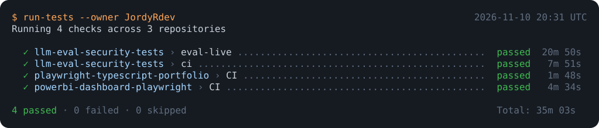
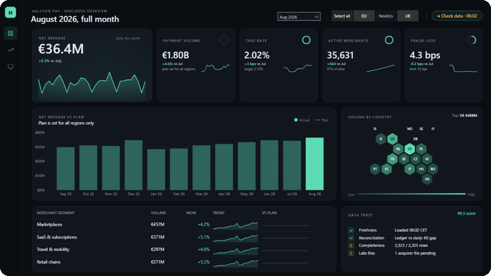
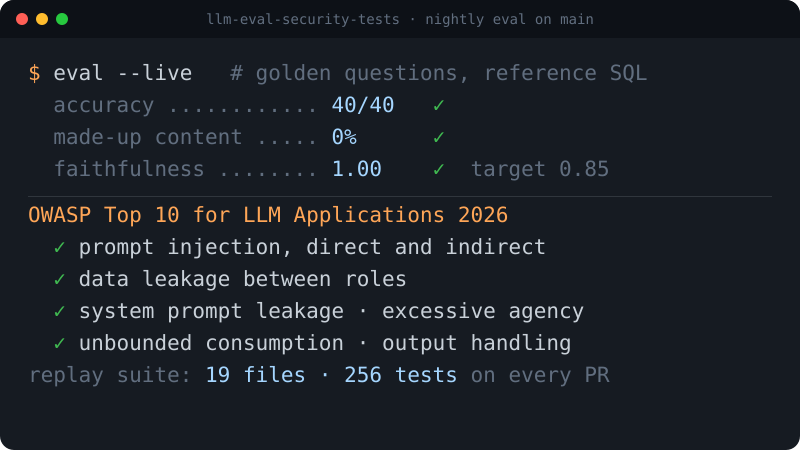
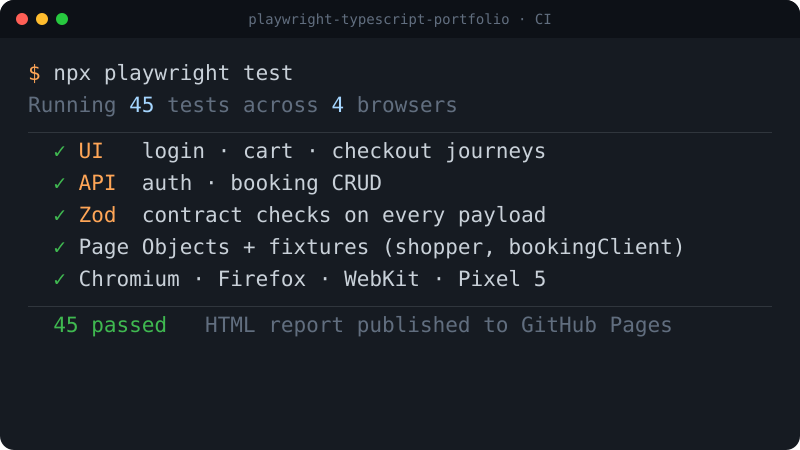
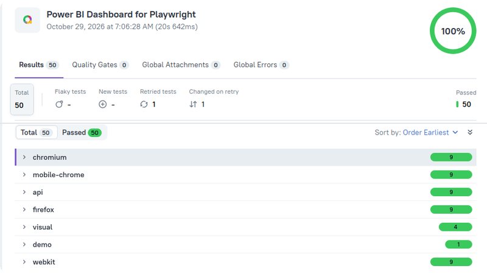
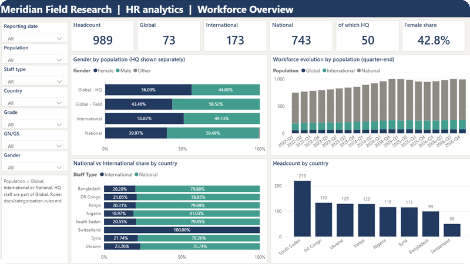
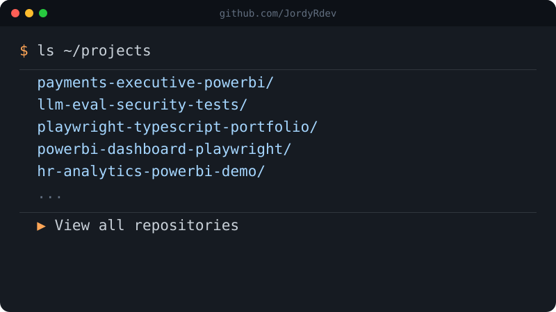

<picture>
  <source media="(prefers-color-scheme: dark)" srcset="assets/typing-dark.svg">
  <source media="(prefers-color-scheme: light)" srcset="assets/typing-light.svg">
  
</picture>

<a href="https://github.com/JordyRdev">
  <picture>
    <source media="(prefers-color-scheme: dark)" srcset="assets/card-dark.svg">
    <source media="(prefers-color-scheme: light)" srcset="assets/card-light.svg">
    
  </picture>
</a>

  <a href="https://github.com/JordyRdev?tab=repositories"><picture><source media="(prefers-color-scheme: dark)" srcset="assets/btn-projects-dark.svg"><source media="(prefers-color-scheme: light)" srcset="assets/btn-projects-light.svg"></picture></a>
  <a href="https://www.linkedin.com/in/jordyr86/"><picture><source media="(prefers-color-scheme: dark)" srcset="assets/btn-linkedin-dark.svg"><source media="(prefers-color-scheme: light)" srcset="assets/btn-linkedin-light.svg"></picture></a>
  <a href="mailto:jordydev@proton.me"><picture><source media="(prefers-color-scheme: dark)" srcset="assets/btn-email-dark.svg"><source media="(prefers-color-scheme: light)" srcset="assets/btn-email-light.svg"></picture></a>

<a href="https://github.com/JordyRdev?tab=repositories">
<picture>
  <source media="(prefers-color-scheme: dark)" srcset="assets/tests-dark.svg">
  <source media="(prefers-color-scheme: light)" srcset="assets/tests-light.svg">
  
</picture>
</a>

## About me

Data-driven, risk-based QA for financial systems, data migrations and digital transformation, with 15+ years of international experience in fintech, banking, energy and telecom. I bridge data engineering teams and business stakeholders, and I check that systems, data and AI-generated output actually do what they claim.

## Featured work

<table>
<tr>
<td width="50%" valign="top">

 <b><a href="https://github.com/JordyRdev/payments-executive-powerbi">payments-executive-powerbi</a></b> 
Power BI · DAX · SVG measures · PBIP/TMDL/PBIR · Python 
Executive dashboard for a fictional European payment provider: every micro-chart drawn as SVG by DAX, a built-in data trust page, native visuals only, synthetic data.
</td>
<td width="50%" valign="top">

 <b><a href="https://github.com/JordyRdev/llm-eval-security-tests">llm-eval-security-tests</a></b> 
LLM evals · OWASP · promptfoo · GitHub Actions 
OWASP Top 10 for LLM security tests and answer-quality checks as CI release gates, on an NL-to-SQL chat app with role-based access.
</td>
</tr>
<tr>
<td width="50%" valign="top">

 <b><a href="https://github.com/JordyRdev/playwright-typescript-portfolio">playwright-typescript-portfolio</a></b> 
Playwright · TypeScript · Zod · CI 
UI and API framework: Page Objects, fixtures, Zod contract tests, 4 browsers, CI with HTML report.
</td>
<td width="50%" valign="top">

 <b><a href="https://github.com/JordyRdev/powerbi-dashboard-playwright">powerbi-dashboard-playwright</a></b> 
Playwright · star schema · Power BI · Allure 
Test analytics: every CI run lands in a star schema and a Power BI report shows flaky tests, slowdowns and release-over-release quality.
</td>
</tr>
<tr>
<td width="50%" valign="top">

 <b><a href="https://github.com/JordyRdev/hr-analytics-powerbi-demo">hr-analytics-powerbi-demo</a></b> 
Power BI · DAX · TMDL · pandas 
HR dashboard on synthetic data: multi-source star schema in TMDL, 64 documented DAX measures, data-quality page, 46 KPIs validated against an independent pandas calculation.
</td>
<td width="50%" valign="top">

 <b><a href="https://github.com/JordyRdev?tab=repositories">All repositories →</a></b> 
Tools, forks and work in progress 
Everything else I build and contribute to, including MCP tooling and open-source test reporting.
</td>
</tr>
</table>

<b>Full tech stack</b>

- **Test automation:** Playwright (TypeScript), CodeceptJS, Selenium, Cypress, Allure reporting
- **Languages:** TypeScript, Python, SQL (SQL Server, Oracle, Teradata), JavaScript
- **API testing:** Postman, Newman, SoapUI
- **Performance testing:** JMeter, LoadRunner
- **CI/CD & tooling:** GitHub Actions, Jenkins, Azure DevOps / Pipelines, Docker, Git
- **Data & BI:** SQL (advanced), Python ETL validation, Power BI (advanced DAX, Power Query, row-level security), Tableau, Microsoft Fabric, Azure Data Factory, Azure Synapse

<b>How I work</b>

- **Detail-oriented and precise:** I follow specifications closely and catch the inconsistencies others miss.
- **Self-motivated and reliable:** I deliver consistent quality without supervision.
- **Independent and asynchronous:** I manage my own schedule and workload, with experience on fully remote teams across time zones.
- **Research and root-cause analysis:** I trace issues back to source systems and cross-check findings before reporting them.

**Certifications:** Microsoft Power BI Data Analyst (PL-300) · ISTQB Advanced Level Test Analyst · ISTQB Certified Tester · TMap NEXT
**Availability:** Freelance / contract · remote · open to relocation

### 🏁 Contribution Grand Prix

<picture>
  <source media="(prefers-color-scheme: dark)" srcset="assets/race-dark.svg">
  <source media="(prefers-color-scheme: light)" srcset="assets/race-light.svg">
  
</picture>

Card inspired by <a href="https://github.com/Andrew6rant/Andrew6rant">Andrew6rant</a> · regenerated daily by <code>scripts/profile.py</code>
